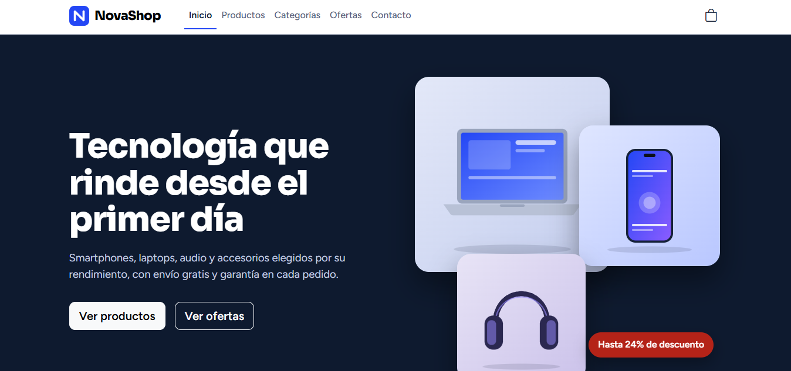
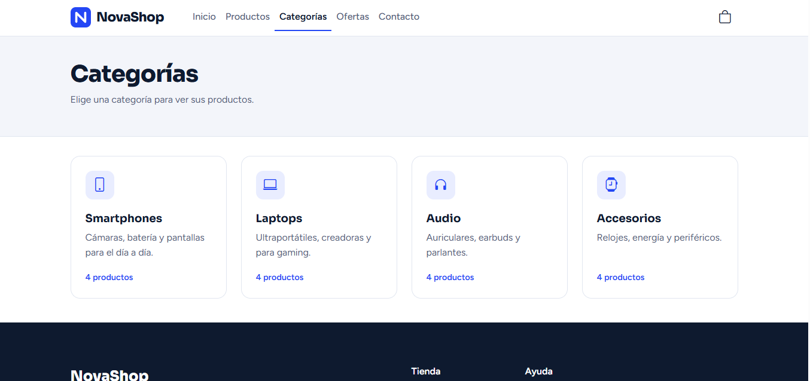
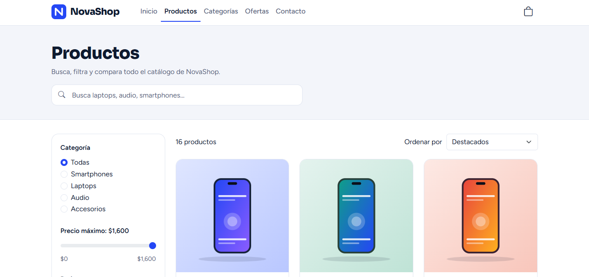
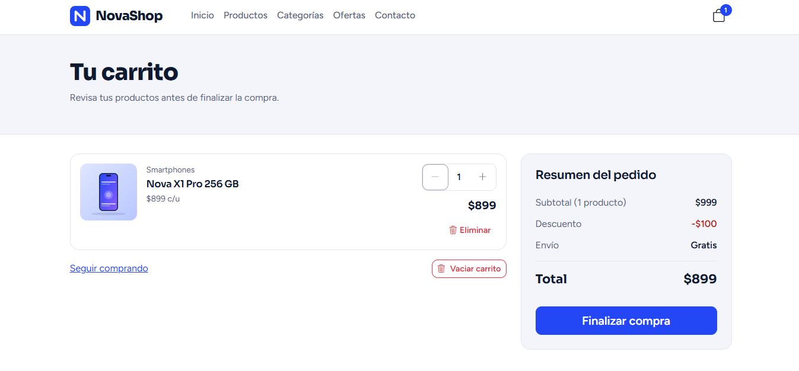
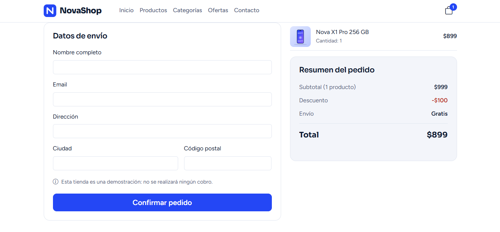
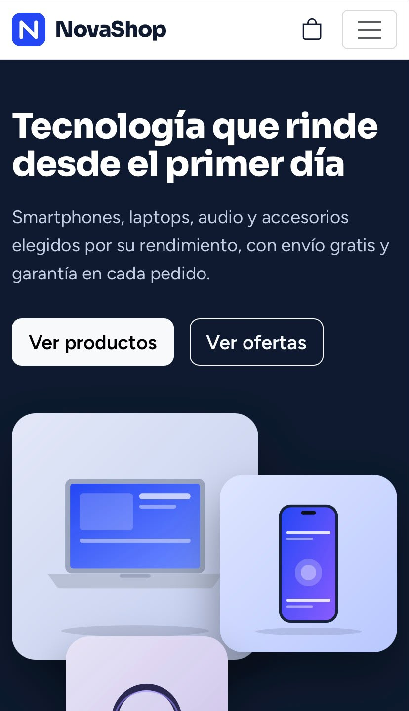

# NovaShop

NovaShop es una tienda online de tecnología y accesorios que desarrollé como parte de mi portafolio.

Permite explorar un catálogo de productos, buscar artículos, aplicar filtros, consultar detalles y gestionar un carrito de compras. También incluye un proceso de compra simulado con una pantalla de confirmación.

La aplicación funciona completamente desde el frontend, sin backend ni base de datos. Los productos, precios y pedidos son ficticios y no se realizan pagos reales.

**Demostración:** [Ver NovaShop](https://novashop-b2529.web.app/)

**Repositorio:** [GitHub](https://github.com/juanbecerrap/NovaShop)

## Capturas de pantalla

| Inicio | Catálogo |
|---|---|
|  |  |

| Detalle de producto | Carrito de compras |
|---|---|
|  |  |

| Proceso de compra | Vista móvil |
|---|---|
|  |  |

## Funcionalidades

- Página de inicio con categorías, productos destacados, ofertas y beneficios.
- Catálogo con 16 productos distribuidos en cuatro categorías: smartphones, laptops, audio y accesorios.
- Búsqueda por nombre o categoría.
- Filtros por categoría, precio máximo, valoración y ofertas.
- Ordenamiento por precio, valoración y popularidad.
- Página de detalle con galería de imágenes, características, selector de cantidad y productos relacionados.
- Carrito con opciones para agregar productos, modificar cantidades, eliminarlos y vaciarlo.
- Cálculo de subtotal, descuentos y total.
- Persistencia del carrito mediante `localStorage`.
- Formulario de compra con validación y pantalla de confirmación.
- Formulario de contacto.
- Diseño adaptable a dispositivos móviles, tabletas y computadores.
- Accesibilidad básica mediante textos alternativos, etiquetas de formulario, foco visible y enlace para saltar al contenido principal.

## Tecnologías utilizadas

| Tecnología | Uso |
|---|---|
| React 18 | Construcción de la interfaz mediante componentes |
| JavaScript (ES6+) | Lógica de la aplicación |
| Vite | Entorno de desarrollo y compilación |
| HTML5 | Estructura de las páginas |
| CSS3 | Estilos y diseño responsive |
| Bootstrap 5 | Componentes y estilos |
| Bootstrap Icons | Iconos de la interfaz |
| React Router 6 | Navegación entre páginas |
| Context API | Gestión del estado global del carrito |
| LocalStorage | Persistencia del carrito en el navegador |
| Firebase Hosting | Publicación de la aplicación |
| Git y GitHub | Control de versiones y almacenamiento del código |

## Estructura del proyecto

```text
NovaShop/
├── public/
│   └── products/       # Imágenes de los productos
├── src/
│   ├── assets/         # Logo y recursos visuales
│   ├── components/     # Componentes reutilizables
│   ├── context/        # Estado global del carrito
│   ├── data/           # Productos y categorías
│   ├── hooks/          # Hooks personalizados
│   ├── pages/          # Páginas de la aplicación
│   ├── styles/         # Estilos personalizados
│   ├── utils/          # Utilidades y validaciones
│   ├── App.jsx         # Rutas y estructura principal
│   └── main.jsx        # Punto de entrada
├── docs/
│   └── screenshots/    # Capturas de pantalla
├── package.json
└── README.md
```

## Instalación y ejecución local

### Requisitos

- Node.js 18 o superior.
- npm.

### 1. Clonar el repositorio

Abre CMD o una terminal y ejecuta:

```cmd
git clone https://github.com/juanbecerrap/NovaShop.git
cd NovaShop
```

### 2. Instalar las dependencias

```cmd
npm install
```

### 3. Iniciar el servidor de desarrollo

```cmd
npm run dev
```

Vite mostrará la dirección local en la terminal. Normalmente, la aplicación estará disponible en:

[http://localhost:5173](http://localhost:5173)

### 4. Generar la versión de producción

```cmd
npm run build
```

Los archivos generados se guardarán en la carpeta `dist/`.

### 5. Previsualizar la versión de producción

```cmd
npm run preview
```

## Decisiones técnicas

### Persistencia del carrito

Utilicé `localStorage` para conservar el carrito cuando se recarga la página o se vuelve a abrir la aplicación en el mismo navegador.

Se guardan los identificadores de los productos y sus cantidades. Los nombres, precios y demás datos se obtienen del catálogo para evitar duplicar información.

### Búsqueda, filtros y ordenamiento

La lógica de búsqueda, filtrado y ordenamiento está centralizada en el hook personalizado `useProductFilters`. Esto permite reutilizarla en las páginas de productos y ofertas, evitando repetir código.

### Imágenes de los productos

Las imágenes se almacenan localmente en formato SVG. De esta manera, la aplicación no depende de servicios externos para mostrar los productos.

### Proceso de compra

El checkout permite completar un formulario, validar los datos y visualizar una confirmación del pedido. Es una simulación para demostrar el flujo de compra de una tienda online; no procesa pagos ni genera pedidos en un servidor.

## Despliegue

NovaShop está publicado mediante Firebase Hosting.

**Demostración:** [https://novashop-b2529.web.app/](https://novashop-b2529.web.app/)

Para publicar una nueva versión, es necesario generar la compilación de producción y desplegar el contenido de `dist/` utilizando la configuración de Firebase del proyecto.

## Limitaciones

- No tiene backend ni base de datos.
- Los productos y sus precios son datos de ejemplo.
- El carrito se guarda únicamente en el navegador.
- El proceso de compra es simulado y no procesa pagos reales.
- Los pedidos no se almacenan en un servidor.
- El formulario de contacto no implica el envío de mensajes a un sistema externo.

## Objetivo del proyecto

Con NovaShop practiqué la creación de una tienda online con React, la organización de componentes, la navegación entre páginas y la gestión del estado del carrito. También trabajé en la búsqueda y los filtros de productos, la adaptación de la interfaz a dispositivos móviles y la publicación de una aplicación web.

## Autor

**Juan Angel Becerra Padilla**

- [GitHub](https://github.com/juanbecerrap)
- [LinkedIn](https://www.linkedin.com/in/juanbecerrap/)